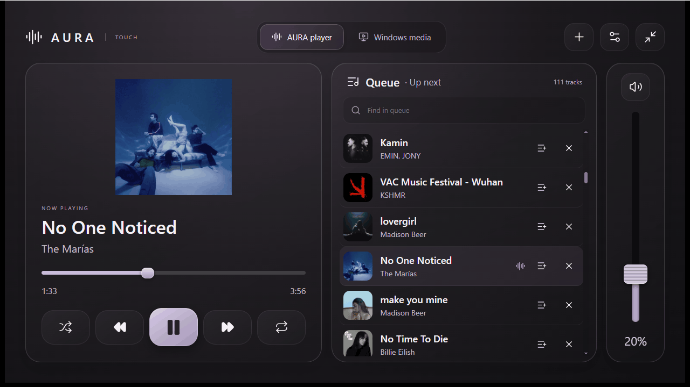
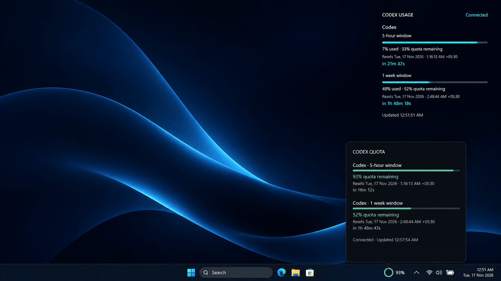
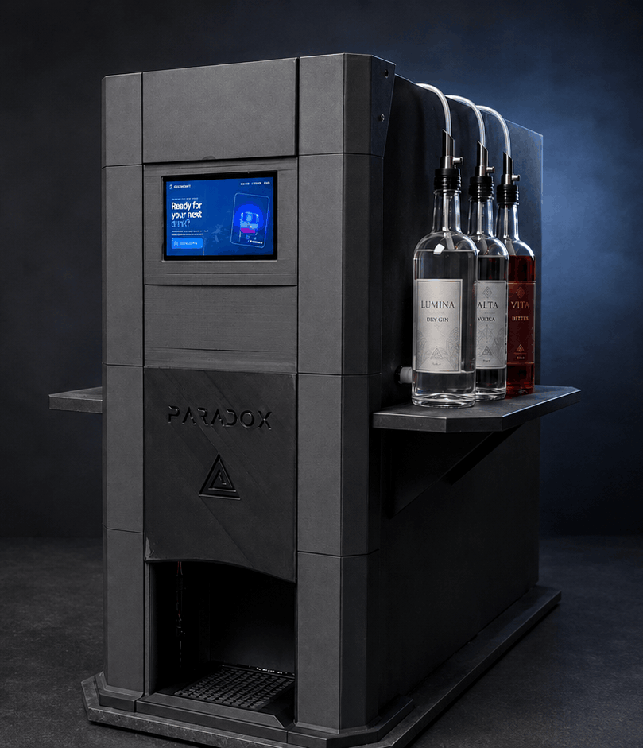

# Kaveesha Nethmal

**Information Technology undergraduate · University of Moratuwa, Sri Lanka**

Most of my personal projects begin with something I need, not an idea for a portfolio. I look for a tool, find something missing, and end up making my own. Then I keep changing it because I'm the one using it.

---

## On my desktop

### 01 / MusicPlayerDock

I wanted playback controls that appear when I need them and otherwise leave the desktop alone. I built a top-edge Windows dock, then spent a lot more time than expected trying to make **actual refraction and magnification** work instead of using another blurred, translucent panel.

Electron · React · TypeScript · .NET 8 · Windows media sessions · real-time desktop capture

  
  Black Notch — the original version is still an option.

---

### 02 / AURA

My music collection needed a player that worked the way I wanted. AURA now has local library and queue management, synchronized lyrics, waveform seeking, equalization, and a redesigned desktop interface. I also made a **separate touch layout** and added control of compatible Windows media sessions.

Electron · React · TypeScript · Web Audio API · Windows media bridge

  
  Fullscreen touch controls, queue, and vertical volume fader.

---

## Another tool I use

### Codex Usage Widget

  

I wanted to see **real quota percentages and reset times** without opening the CLI every time. This is a Windows desktop and taskbar widget that reads the local Codex app-server's reported values, including the remaining time for each available window.

---

## Work with a team

### ChainOps · Smart contract DevSecOps

  

We're building a platform to connect smart-contract builds, tests, security reviews, approvals, deployments, and monitoring. I've worked mainly on the **UI/UX and the flow between those areas**. It's an ongoing university team project.

---

## Hardware, mechanics & 3D

### CocktailCraft · Team build

  

Working on an automated dispenser took me into custom 3D-printed mechanisms, mixer and pinch-valve design, embedded logic, and putting the hardware together. I worked on the mechanical and integration side as part of the team.

---

## Smaller things I made

- **[Telegram Large File Splitter Bot](https://github.com/kaveesha-neth/split-bot)** — Splits large Telegram files into manageable parts on an Oracle Cloud VM and sends them back with progress updates. `Python` · `Telethon` · `Docker`
- **[EduMentor AI](https://github.com/kaveesha-neth/EduMentor-AI)** — Adaptive study plans, worked examples, quizzes, and progress tracking, built for a Build with AI event. `Python` · `Google ADK` · `Gemini`
- **Local Data Usage Monitor** — A Windows background service to keep track of my own daily network usage. `Python` · `Flask` · `psutil`
- **[KN-Calc](https://github.com/kaveesha-neth/KN-calc)** — A simple keyboard-friendly browser calculator. `HTML` · `CSS` · `JavaScript`

---

## Technical toolkit

**Languages**

  
  
  
  
  
  

**Desktop & web**

  
  
  
  
  
  
  
  

**Systems & hardware**

  
  
  
  
  
  
  

**Design & prototyping**

  
  
  
  
  

---

I'm studying IT at the **University of Moratuwa**, and spending more time on computer networks, operating systems, embedded systems, and cybersecurity. Most of what I learn ends up being useful for something I'm building.
