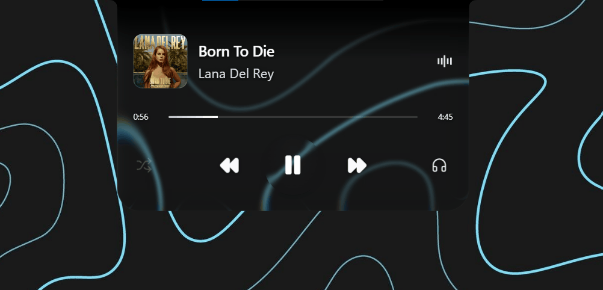
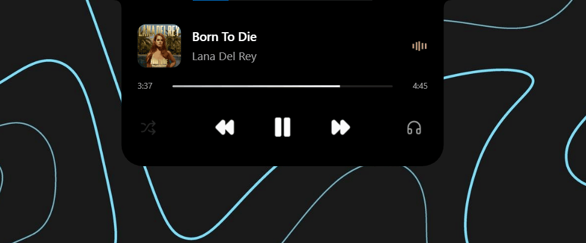
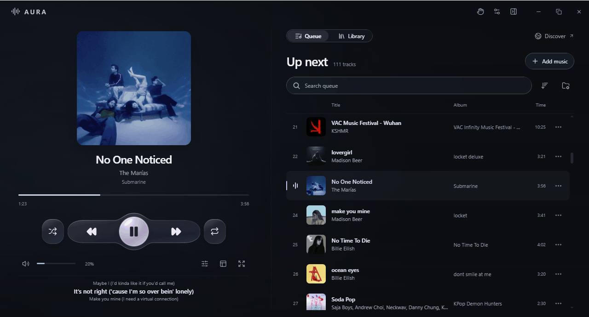

<!-- GitHub profile introduction — Kaveesha Nethmal -->

  PERSONAL PROFILE &nbsp; / &nbsp; SRI LANKA

<h1 align="center">Kaveesha Nethmal</h1>

  

  <strong>Software Developer · Information Technology Undergraduate</strong> 
  University of Moratuwa · Sri Lanka

---

  <em>Curiosity about how things work. An interest in understanding, building, and improving them.</em>

An undergraduate with a broad interest in technology and engineering, particularly the systems and ideas that make things work. Drawn to understanding how components interact, why things are designed the way they are, and how those ideas translate into practical solutions.

Interests span software development, operating systems, computer networks, electronics, mechanical engineering, and design. Learning is approached through exploration and hands-on experimentation, with an emphasis on understanding concepts beyond their surface-level application.

Currently exploring **computer networks, systems engineering, and cybersecurity**, alongside ongoing software and hardware projects.

  SOFTWARE &nbsp; / &nbsp; SYSTEMS &nbsp; / &nbsp; HARDWARE &nbsp; / &nbsp; DESIGN

  <a href="https://github.com/kaveesha-neth?tab=repositories">REPOSITORIES</a>
  &nbsp; · &nbsp;
  <a href="https://github.com/kaveesha-neth/AURA/releases/latest">AURA</a>
  &nbsp; · &nbsp;
  <a href="https://github.com/kaveesha-neth/music-player-dock/releases/latest">MUSIC PLAYER DOCK</a>

---

## Things I've built for my own setup

These started as things I wanted to use, and they're still the ones I keep going back to and changing.

### MusicPlayerDock

WINDOWS &nbsp; / &nbsp; DESKTOP UTILITY

I wanted music controls at the top of my Windows screen, but only when I needed them. The first version was a simple black notch. Later, I wanted it to behave more like actual glass, which led me into **live desktop capture, refraction, magnification, reflections, and performance problems** that took a lot more work than the dock itself.

Electron · React · TypeScript · .NET 8 · Windows media sessions · real-time rendering

  
  

Where it started — Black Notch

---

### AURA

WINDOWS &nbsp; / &nbsp; MUSIC PLAYER

I wanted a local music player that felt right for how I listen. AURA grew from a player for my own music into an app with **library and queue management, synchronized lyrics, waveform seeking, equalization, and a separate touch interface**. I also worked on controlling compatible Windows media sessions from inside it.

Electron · React · TypeScript · Web Audio API · .NET 8 / WinRT

  
  

AURA on a touch display

---

### Codex Usage Widget

WINDOWS &nbsp; / &nbsp; TASKBAR &amp; DESKTOP

I wanted to check my Codex quota without repeatedly opening another window. So I made a desktop and taskbar widget that reads the **actual usage windows and reset times reported by the local Codex app-server**, rather than estimating them.

.NET 8 · Windows desktop integration · local app-server

---

## Building with other people

### ChainOps

UNIVERSITY TEAM PROJECT &nbsp; / &nbsp; SMART CONTRACT DEVSECOPS

ChainOps is a team project bringing smart-contract builds, testing, security analysis, approvals, deployment, and monitoring into a more connected workflow. I've worked particularly on the **interface design and the way these areas fit together**, using Figma and working with the team's application structure. It's still under development.

React · TypeScript · Figma · Git / pull requests

---

### CocktailCraft

TEAM HARDWARE PROJECT &nbsp; / &nbsp; MECHANICAL &amp; EMBEDDED SYSTEMS

An automated beverage dispenser that brought together software, electronics, motors, and physical mechanisms. I worked on **mechanical design, the mixer and pinch-valve mechanisms, 3D-printed parts, embedded logic, and assembly/integration**. It was a useful reminder that getting something working in the physical world is very different from getting it working on a screen.

ESP32 · Raspberry Pi · Embedded control · Fusion 360 · Blender · 3D printing

---

## A few smaller things

Not everything needs a big interface. Some tools are useful precisely because they do one job.

**[Telegram Large File Splitter Bot](https://github.com/kaveesha-neth/split-bot)**  
A Dockerized Python and Telethon service for downloading large Telegram files on a cloud VM, splitting them into RAR volumes, and sending them back with progress updates. Python · Telethon · Docker · Oracle Cloud

**[EduMentor AI](https://github.com/kaveesha-neth/EduMentor-AI)**  
An adaptive study agent I built for a Build with AI event. It makes learning plans, walks through examples, quizzes, explains mistakes, and keeps track of session progress. Python · Google ADK · Gemini

**Local Data Usage Monitor**  
A Windows background utility I made to record daily network usage on my own computer. Python · Flask · psutil

**[KN-Calc](https://github.com/kaveesha-neth/KN-calc)**  
A simple browser calculator with keyboard input. HTML · CSS · JavaScript

---

## Technical toolkit

These are tools I've used across coursework, personal projects, and team builds — not a list of things I claim to have mastered.

**Languages**

  
  
  
  
  
  

**Desktop & web**

  
  
  
  
  
  
  
  

**Systems & hardware**

  
  
  
  
  
  
  

**Design & prototyping**

  
  
  
  
  

