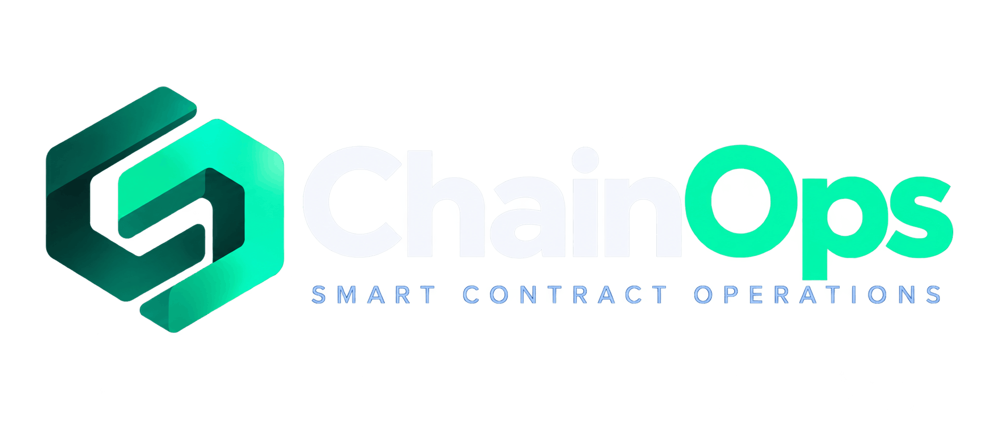

# Kaveesha Nethmal

**Information Technology undergraduate · University of Moratuwa, Sri Lanka**

I mostly build things because I want to use them. A missing feature, an inconvenient workflow, or something I wish existed on my own setup usually comes first. The project comes later. Some stay small; others turn into applications or hardware that I keep working on long after the first version runs.

[My repositories](https://github.com/kaveesha-neth?tab=repositories) · [AURA releases](https://github.com/kaveesha-neth/AURA/releases/latest) · [MusicPlayerDock releases](https://github.com/kaveesha-neth/music-player-dock/releases/latest)

---

## Things I've built

<table>
<tr>
<td width="50%" valign="top">
  
  <h3><a href="https://github.com/kaveesha-neth/music-player-dock">MusicPlayerDock</a></h3>
  
I wanted music controls at the top of my Windows screen, available when I needed them and out of the way otherwise. It started as a black notch. Then I wanted actual glass, not just a translucent blur, and ended up working on live desktop capture, refraction, magnification, reflections, and the rendering cost that comes with them.

  
Electron · React · TypeScript · .NET 8 · Windows media sessions · real-time rendering

  
<a href="https://github.com/kaveesha-neth/music-player-dock">Source</a> · <a href="https://github.com/kaveesha-neth/music-player-dock/releases/latest">Windows download</a>

</td>
<td width="50%" valign="top">
  
  <h3><a href="https://github.com/kaveesha-neth/AURA">AURA</a></h3>
  
I wanted a local music player that worked the way I like to listen. AURA grew into a Windows desktop app with library and queue management, synchronized lyrics, waveform seeking, an equalizer, and a redesigned React interface. I also added a touch-oriented layout and integration with compatible Windows media sessions.

  
Electron · React · TypeScript · Web Audio API · .NET 8 / WinRT

  
<a href="https://github.com/kaveesha-neth/AURA">Source</a> · <a href="https://github.com/kaveesha-neth/AURA/releases/latest">Windows download</a>

</td>
</tr>
<tr>
<td width="50%" valign="top">
  
  <h3><a href="https://github.com/kaveesha-neth/codex-usage">Codex Usage Widget</a></h3>
  
I wanted to see my Codex quota and reset times without repeatedly opening another window. This Windows desktop and taskbar widget reads the values reported by the local Codex app-server. It shows the available quota windows and countdowns rather than inventing usage estimates.

  
.NET 8 · Windows desktop / taskbar integration · local app-server

  
<a href="https://github.com/kaveesha-neth/codex-usage">Source and documentation</a>

</td>
<td width="50%" valign="top">
  

    
  

  <h3><a href="https://github.com/intelli-collective/ChainOps">ChainOps</a> · Team project</h3>
  
A university team project to bring fragmented smart-contract workflows into one place: builds, tests, security findings, approvals, deployment, and monitoring. My work has focused heavily on the UI/UX and how these stages connect in a usable product. This is ongoing team development, not a finished commercial service.

  
React · TypeScript · Figma · DevSecOps workflows · Git / pull requests

  
<a href="https://github.com/intelli-collective/ChainOps">Team repository</a>

</td>
</tr>
</table>

<b>More views — earlier design and touch controls</b>

 
<table>
<tr>
<td width="50%" valign="top">
  
  
MusicPlayerDock's Black Notch mode — where this project started.

</td>
<td width="50%" valign="top">
  
  
AURA's touch interface, with a queue and full-height volume control.

</td>
</tr>
</table>

## Smaller tools and experiments

Not everything needs to become a big application. Sometimes I just need a utility that does one job properly.

| Project | Why I built it / what it does |
| --- | --- |
| **[Telegram Large File Splitter Bot](https://github.com/kaveesha-neth/split-bot)** | I needed a less manual way to handle large Telegram files. I made a Dockerized Python/Telethon service that downloads, splits, and sends files back in parts, with progress updates. |
| **[EduMentor AI](https://github.com/kaveesha-neth/EduMentor-AI)** | An adaptive study agent made for a Build with AI event. It generates learning plans, works through examples, quizzes students, explains mistakes, and keeps session progress. Built with Python, Google ADK, and Gemini. |
| **Local Data Usage Monitor** | A personal Windows background service for tracking my own network usage and retaining daily records, built with Python, Flask, and psutil. |
| **[KN-Calc](https://github.com/kaveesha-neth/KN-calc)** | A small keyboard-friendly web calculator — one of my simpler browser projects. |

## Hardware, mechanics, and 3D work

I've also worked on a team-built automated beverage dispenser. My contributions have included mechanical design, custom 3D-printed parts, mixer and pinch-valve mechanisms, embedded control logic, and assembly and integration. It brought together firmware, electronics, motors, sensors, and physical mechanisms — very different problems from making a desktop application.

I use **Blender**, **Fusion 360**, and 3D printing alongside programming. I also work with **Photoshop** and interface design; the visual side of a project matters to me, but it still needs to work.

## Tools I work with

| Area | Tools and technologies |
| --- | --- |
| **Languages** | TypeScript, JavaScript, Python, C, Java, SQL |
| **Desktop and web** | Electron, React, Node.js, Flask, HTML/CSS, Web Audio API, Windows APIs, .NET / WinRT |
| **Systems and hardware** | Docker, Git, Linux, ESP32, Raspberry Pi, Arduino, sensors, motors, 3D printing |
| **Design and prototyping** | Figma, Photoshop, Blender, Fusion 360 |

## What I'm learning more about

I'm studying Information Technology at the **University of Moratuwa**. I'm particularly interested in computer networks, operating systems, embedded systems, and cybersecurity. I want to understand systems at a lower level, not just use the abstractions on top of them.

The projects above are a mix of personal tools, experiments, and team work. Most of the personal ones are things I still use or keep changing because I keep finding new ways I want them to work.
